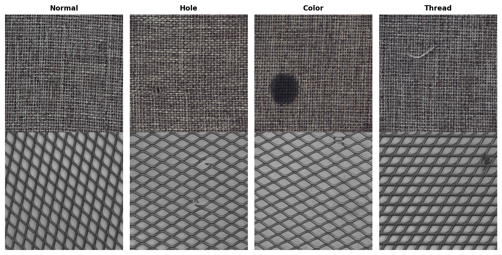
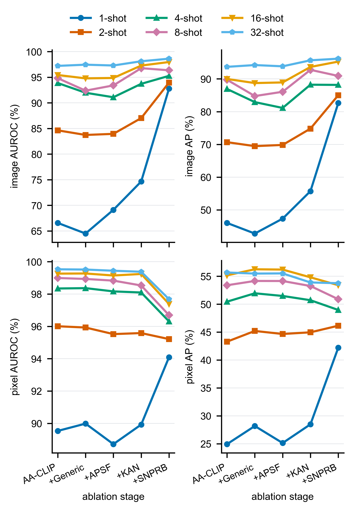
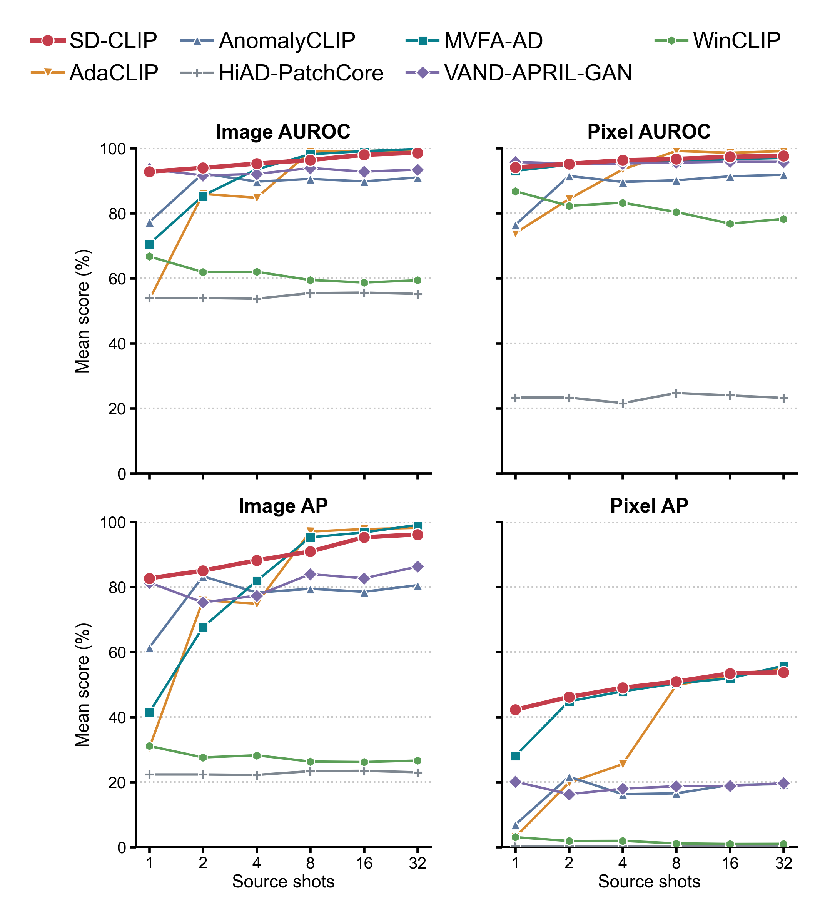

<div align="center">

<h1>🛰️ SD-CLIP</h1>

**P**eriodicity-**A**ware **S**emantic–**V**isual **A**daptation for **C**ross‑Domain **F**ew‑Shot **A**nomaly **D**etection

Cross-domain few-shot anomaly detection for **periodic visual patterns** — e.g. AMOLED display panels and periodic-texture industrial surfaces.


---

This repository is the public companion code of the SD-CLIP paper ***(under review)***.

</div>

---

## ✨ Highlights

- 🚀 **Full pipeline** — two-stage training (text adaptation → visual adaptation), evaluation, and per-sample **visualizations** in one codebase.
- 🔓 **Open MVTec-Periodic recipe** — rebuild the two periodic-texture subsets (`carpet`, `grid`) from the public [MVTec-AD](https://www.mvtec.com/company/research/datasets/mvtec-ad) dataset with a single script.
- 📐 **AMOLED format, open** — the *organizational format* (without the private images) of the proprietary AMOLED dataset used in the paper, plus a **synthetic dummy generator** so every stage runs end-to-end on any machine.
- 📊 **Deterministic few-shot protocol** — evaluated over multiple seeds, shots `1→32`, strictly nested support, full-target test, checkpoint fixed at epoch 5.

---

## 🖼️ A look at the data

The benchmark focuses on **periodically structured surfaces**. Below are representative samples with ground-truth masks from the two open MVTec-Periodic subsets:

<p align="center">
  
  <br/>
  <em>Fig. 1 — MVTec-Periodic samples: normal / anomalous images with ground-truth masks (carpet top, grid bottom).</em>
</p>

---

## 🧭 Method overview

The paper studies *when CLIP-style text–image alignment helps periodic anomaly detection* and builds a five-level ablation:

| id  | method                             | training prompts | visual layer | inference prompts                        |
|-----|------------------------------------|------------------|--------------|------------------------------------------|
| c0  | **AA-CLIP**                        | `aa` (semantic)  | SimpleAdapter | `aa`                                     |
| c1  | **AA-CLIP + Generic Prompts**      | `mvfa` (generic) | SimpleAdapter | `mvfa`                                   |
| c2  | **APSF** (Adaptive Periodic Sem. Fusion) | `mvfa`     | SimpleAdapter | `apsf` (learned λ)             |
| c3  | APSF + KAN-Residual (no mem.)      | `mvfa`           | KAN-Residual  | `apsf`                                   |
| c4  | **SD-CLIP** (c3 + SNPRB)           | `mvfa`           | KAN-Residual  | `apsf` + source-normal patch reference bank |

### 🧩 Key ingredients

- 🧵 **Generic Prompts** — semantic prompts that never reference the target defect class, keeping the text anchor **invariant across domains**.
- ⚖️ **APSF** — per-class fusion of the generic anchor and a periodicity-aware anchor; the fusion weight **λ is learned from the source support** (init 0.5) at inference time.
- 🔧 **KAN-Residual** — a KAN-based residual visual adapter (bottleneck 16, grid 2, spline order 2).
- 🗂️ **SNPRB** — Source-Normal Patch Reference Bank optionally fused into the anomaly score at pixel level (`--memory-weight 0.75`).

### 📈 Results

Component ablation and comparison against reference methods on MVTec-Periodic (image & pixel AUROC):

<p align="center">
  
  <br/>
  <em>Fig. 2 — Component ablation: each block of SD-CLIP contributes consistently across few-shot settings.</em>
</p>

<p align="center">
  
  <br/>
  <em>Fig. 3 — Few-shot comparison against reference methods under the same protocol.</em>
</p>

---

## 📁 Repository layout

```
├── train.py                  # two-stage training (text stage + visual stage)
├── test.py                   # evaluation + visualizations
├── utils.py / forward_utils.py
├── dataset/                  # data loading + prompt/constant definitions
├── model/                    # CLIP backbone, adapters (Simple/KAN-Residual), configs
├── tools/
│   ├── run_mvtec_periodic_ablation.py   # full 5-method ablation runner
│   ├── learn_apsf_weight.py             # APSF λ learner
│   └── summarize_mvtec_periodic_ablation.py
├── scripts/
│   ├── prepare_mvtec_periodic.py        # build MVTec-Periodic from MVTec-AD
│   ├── build_amoled_directional_splits.py
│   └── generate_amoled_dummy_data.py
└── docs/
    ├── amoled_data_organization.md      # AMOLED format spec
    └── figures/                         # figures used in this README
```

---

## 🛠️ Installation

```bash
# Option A: conda
conda env create -f environment.yml
conda activate sd-clip

# Option B: pip (see requirements.txt)
pip install -r requirements.txt
```

Dependencies include **PyTorch 2.3**, `pykan==0.2.8`, timm, kornia, opencv, ftfy, tiktoken, scikit-learn, pandas, tqdm. The CLIP backbone is `ViT-L-14-336` (model config shipped in `model/model_configs/`); follow the standard OpenAI weights download.

---

## 🗃️ Data preparation

### 1. MVTec-Periodic (open, reproducible)

`carpet` and `grid` are the two periodic-texture classes of the official **MVTec-AD** dataset ([download / license terms](https://www.mvtec.com/company/research/datasets/mvtec-ad)). The two subsets are converted here into a single flat layout so they can be used as *source* and *target* domains:

```
data/MVTec-Periodic/carpet/
    images/normal/000.png ... 279.png      # MVTec train/good (280)
    images/normal/t000.png ... t027.png    # MVTec test/good  (28), t prefix
    images/anomaly/color_*.png ...         # MVTec test/{5 defect classes} (89)
    mask/anomaly/color_*.png ...           # MVTec ground_truth (89)
    license.txt / readme.txt               # kept from the official bundle
# grid: 264 + 21 normal, 57 anomalous (5 defect classes)
```

**Offline build** from an already-downloaded official MVTec-AD archive (unzipped, containing `carpet/` and `grid/`):

```bash
python scripts/prepare_mvtec_periodic.py --source-dir /path/to/mvtec_anomaly_detection
```

**Or download automatically** (needs the `mvtec_anomaly_detection_downloader` package; review its terms before use):

```bash
pip install mvtec_anomaly_detection_downloader
python scripts/prepare_mvtec_periodic.py --download
```

Both produce `data/MVTec-Periodic/{carpet,grid}` — the exact directory the runner and the dataloader expect.

### 2. AMOLED (private data, public format + dummy generator)

The AMOLED-ARRAY imagery is proprietary and **not distributed**. Its organizational format is open:

- **Format spec**: [docs/amoled_data_organization.md](docs/amoled_data_organization.md) (directory layout, per-domain `class_name` tags, JSONL schema, split protocol).
- **Dummy generator** 🧪: create synthetic placeholder images/masks in the same format and run the full split pipeline end-to-end:

```bash
python scripts/generate_amoled_dummy_data.py --output-dir dummy_data/amoled_array
python scripts/build_amoled_directional_splits.py \
    --data-root dummy_data/amoled_array --output-root splits/amoled_dummy --dry-run
```

On a machine with access to the private data, pass the real root to the same builder to reproduce the exact paper splits (each JSONL is sha256-pinned).

---

## 🔁 Reproduce the MVTec-Periodic ablation

The runner prepares deterministic splits on the fly (multiple seeds, shots `1,2,4,8,16,32`, both directions), shares checkpoints between methods according to the method matrix, learns λ where required, and evaluates on the full target domain:

```bash
python tools/run_mvtec_periodic_ablation.py --dry-run       # show the plan
python tools/run_mvtec_periodic_ablation.py --slots-per-gpu 1
python tools/summarize_mvtec_periodic_ablation.py --results results/mvtec_periodic_ablation_...
```

Common flags: `--seeds`, `--shots`, `--gpus`, `--epoch 5` (checkpoints are fixed at epoch 5), `--smoke` (single seed/shot sanity run).

---

## 🎮 Manual training / evaluation

`train.py` and `test.py` consume job-local JSONL metadata (`--metadata-path`) so source-support and target-test are always kept separate.

```bash
# ---- Train SD-CLIP (c4) on a carper→grid support --------------------------
python train.py \
  --dataset MVTec-Periodic-carpet \
  --metadata-path splits/.../source_support.jsonl \
  --prompt_mode mvfa --shot 8 --seed <SEED> \
  --text_adapt_weight 0.1 --image_adapt_weight 0.1 \
  --image_adapter_type kan_residual --image_proj_type simple \
  --kan_bottleneck 16 --kan_adapter_bottleneck 16 --kan_proj_bottleneck 16 \
  --kan_grid_size 2 --kan_spline_order 2 \
  --save_path ckpt/carpet_to_grid_s8_s<SEED>

# ---- Learn the APSF fusion weight λ from the same support -----------------
python tools/learn_apsf_weight.py \
  --source MVTec-Periodic-carpet --shot 8 --seed <SEED> \
  --checkpoint-dir ckpt/carpet_to_grid_s8_s<SEED> \
  --metadata-path splits/.../source_support.jsonl \
  --output-dir ckpt/carpet_to_grid_s8_s<SEED>/lambda \
  --epochs 5 --batch-size 64

# ---- Test on the full target domain with visualizations -------------------
python test.py \
  --dataset MVTec-Periodic-grid \
  --metadata-path splits/.../target_test.jsonl \
  --prompt_mode apsf --apsf_weight 0.5 \
  --checkpoint_epoch 5 \
  --save_path ckpt/carpet_to_grid_s8_s<SEED> \
  --metrics_json_path results/carpet_to_grid_s8_s<SEED>.json \
  --visualize --visualize_dir results/vis/carpet_to_grid_s8_s<SEED>
```

Every target-test run should pass `--visualize` with a dedicated `--visualize_dir`; normal samples are visualized too. Visualizations show the input image, the GT mask, and the predicted anomaly heatmap per sample.

---

## 📝 Notes / scope

- ℹ️ The internal identifiers `mvfa` / `apsf` / `periodic` map to *Generic Prompts / APSF / Periodicity-Aware prompts*; they are kept as compatibility names in code, CLI, and results directories.
- ⏱️ Checkpoints are evaluated at fixed epoch 5 (two-stage: text stage 5 epochs, visual stage 5 epochs).
- 🎯 Images in the AMOLED splits carry defocus/angular tilts; the MVTec-Periodic benchmark keeps the same protocol (32-image source pool, strictly nested `ceil(k/2)`/`floor(k/2)` support, full-target test).

---

## 📖 Citation

If you find this repository useful, please cite the paper when it becomes available (under review):

```bibtex
@article{sdclip,
  title  = {SD-CLIP: ... (under review)},
  author = {...},
  journal= {...},
  year   = {2026}
}
```

---

## 📄 License

MIT. MVTec-AD samples referenced by the preparation script are subject to their original license (MVTec AD dataset, CC BY-NC-SA 4.0). The proprietary AMOLED dataset is not part of this repository.